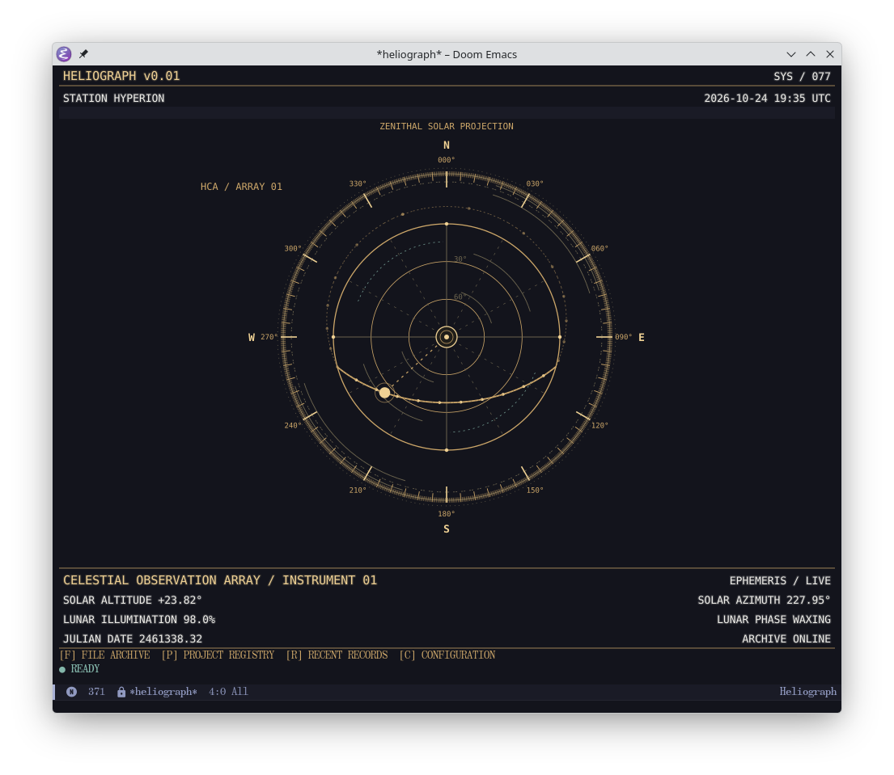
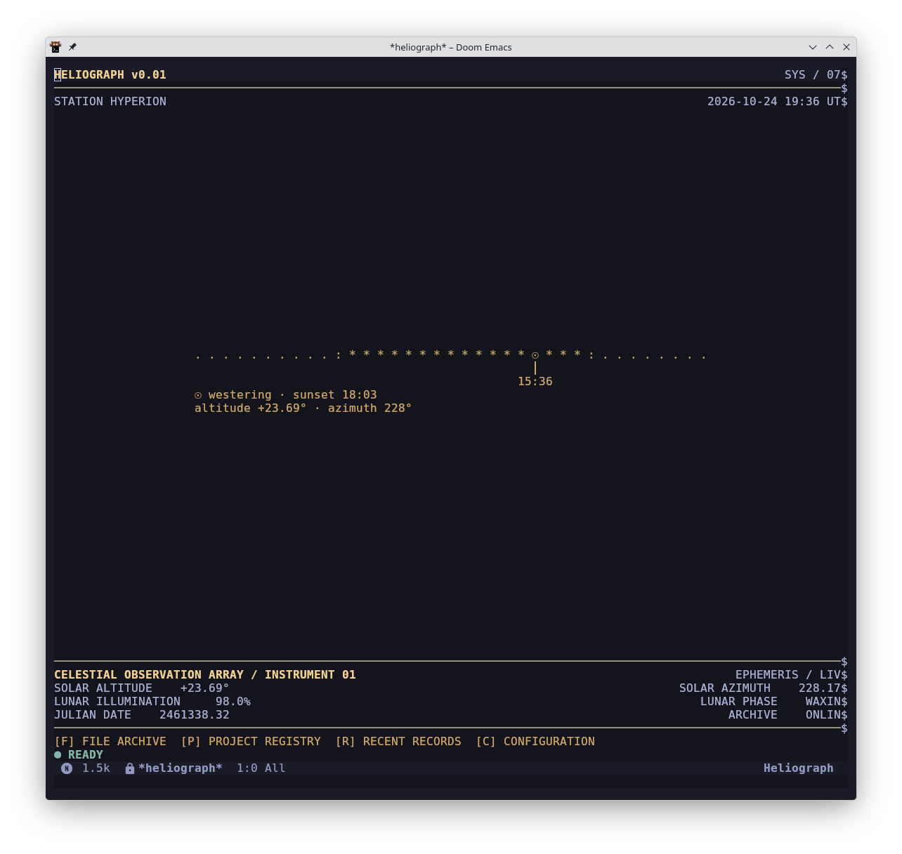

# heliograph

a fictional 1970s heliographic computing authority, implemented as a native emacs dashboard. graphical emacs draws an astronomical svg dial; terminal emacs uses the same layout with native text and a living astronomical inscription. no browser, external process, or third-party elisp dependency.

<table>
  <tr>
    <td width="50%" valign="top"></td>
    <td width="50%" valign="top"></td>
  </tr>
</table>


## quick start

put `heliograph.el` somewhere on your emacs load path, then:

```elisp
(add-to-list 'load-path "~/src/heliograph-el")
(require 'heliograph)
(setq heliograph-station "WADJET"
      heliograph-title "HELIOGRAPH v0.01"
      heliograph-latitude 29.9792
      heliograph-longitude 31.1342)
```

evaluate `M-x heliograph` to open the standalone console.

select a renderer explicitly with `M-x heliograph-svg` or `M-x heliograph-text`.

## doom emacs

add the package to `~/.config/doom/packages.el`:

```elisp
(package! heliograph
  :recipe (:host github :repo "verifiedtm/heliograph-el"))
```

run `doom sync`, then add this to `~/.config/doom/config.el` to open
heliograph as your initial buffer:

```elisp
(use-package! heliograph
  :demand t
  :init
  (setq initial-buffer-choice
        (lambda ()
          (let ((buffer (get-buffer-create "*heliograph*")))
            (with-current-buffer buffer
              (unless (derived-mode-p 'heliograph-mode)
                (heliograph-mode))
              (setq-local heliograph--renderer 'auto)
              (heliograph--render)
              (heliograph--start-timer))
            buffer)))
  :commands (heliograph))
```

this startup setup is incompatible with doom's `:ui dashboard` module; disable
that module in `init.el` when using it.

restart emacs after updating the configuration.

## customization

set these after loading heliograph (in doom, use `after! heliograph`).
set latitude and longitude in decimal degrees, with north and east positive.

| example | purpose |
| --- | --- |
| `(setq heliograph-title "HELIOGRAPH v0.01")` | header text |
| `(setq heliograph-station "YOUR-STATION")` | station name |
| `heliograph-station-formatter` | function formatting the station name for display |
| `heliograph-center-renderer` | custom function for the graphical center instrument |
| `(setq heliograph-latitude 0.0)` | latitude in degrees north |
| `(setq heliograph-longitude 0.0)` | longitude in degrees east |

`heliograph-center-renderer` receives a snapshot and context plist (window size
and palette), and returns a `heliograph-node` containing its image and pixel
dimensions.

## controls

`f` find file, `p` switch project, `r` recent files, `c` customize, `g` refresh, `q` quit.
`[` moves observation time backward, `]` moves it forward, and `n` resumes live observations.

## notes

- requires emacs 28.1+; graphical rendering requires svg image support.
- solar and lunar calculations are approximate.
- refreshes once a minute while visible by default.
